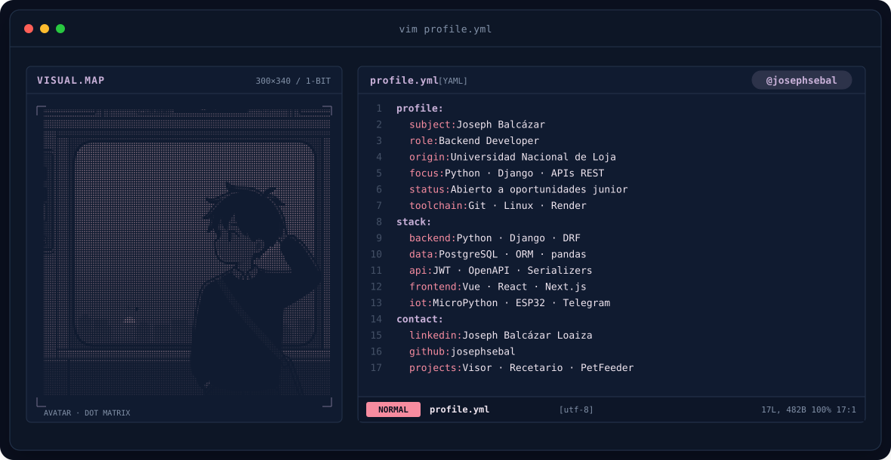
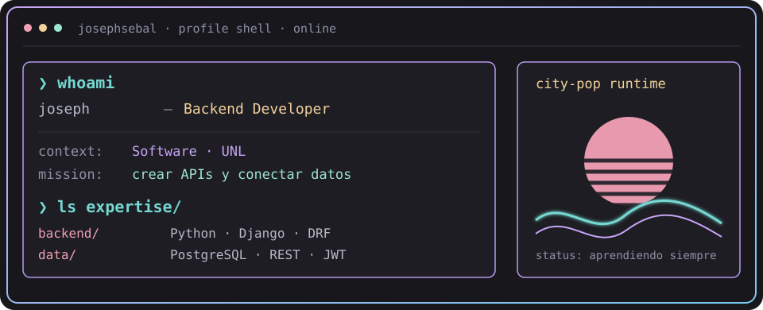
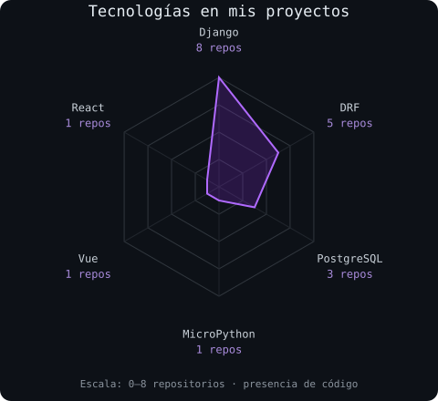
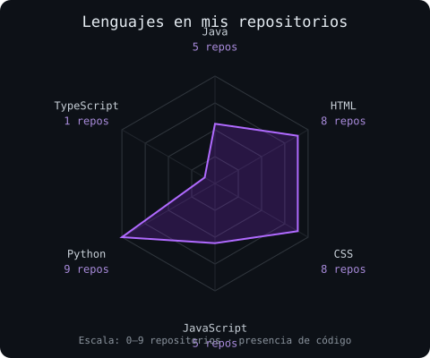

 

 
<b>Abierto a oportunidades backend junior y pasantías</b>

## `$ whoami`

Soy **Joseph Balcázar**, estudiante de Ingeniería de Software en la **Universidad Nacional de Loja**. Desarrollo aplicaciones web y APIs con Python y Django; busco aportar y seguir creciendo dentro de un equipo técnico.

 

## `$ cat tech-stack.yaml`

<table>
<thead><tr><th colspan="2" align="left"><code>josephsebal:~$ cat tech-stack.yaml</code></th></tr></thead>
<tbody>
<tr><td width="50%" align="center"><code>├─ backend:</code>   <code>Python · Django · Django REST Framework</code></td><td width="50%" align="center"><code>├─ databases:</code>   <code>PostgreSQL · MySQL · SQLite</code></td></tr>
<tr><td width="50%" align="center"><code>├─ frontend:</code>   <code>Vue · JavaScript · React · Next.js</code></td><td width="50%" align="center"><code>├─ tools:</code>   <code>Git · GitHub · Linux · Bash</code></td></tr>
<tr><td width="50%" align="center"><code>├─ api_integration:</code>   <code>REST · JWT · OpenAPI · Serializers</code></td><td width="50%" align="center"><code>├─ iot_exploration:</code>   <code>MicroPython · ESP32 · Telegram</code></td></tr>
</tbody><tfoot><tr><td colspan="2" align="center"><code>status: learning &amp; building · focus: backend</code></td></tr></tfoot>
</table>

 

## `$ python portfolio_signals.py`

 

<code>signals: código presente en 23 repositorios recuperados · no son niveles de dominio</code>

## `$ ls projects/`

### 01 / Visor de siniestros
**Django · Django REST Framework · PostgreSQL · pandas**

Backend para consultar siniestros de tránsito y generar información para un visor estadístico. Incluye filtros, indicadores, distribuciones temporales y datos para mapas.

- API de consulta con ViewSets, serializers y filtros con django-filter.
- Agregaciones mediante el ORM para indicadores y evolución anual.
- Caché de respuestas y documentación de endpoints con drf-spectacular.

[Explorar repositorio →](https://github.com/jcbastianl/visor_siniestros) · [Ver implementación de la API](https://github.com/jcbastianl/visor_siniestros/blob/main/siniestros/views.py)

### 02 / Recetario
**Python · Django REST Framework · JWT · Vue**

Aplicación de recetas con backend e interfaz web. El backend gestiona recetas, categorías, usuarios e imágenes.

- Endpoints para consultar y crear recetas, con validación de datos.
- Autenticación con JWT y rutas protegidas.
- Carga de imágenes y documentación de operaciones con Swagger.

[Backend →](https://github.com/jcbastianl/backendRecetario) · [Aplicación y frontend →](https://github.com/jcbastianl/Recetario)

### 03 / PetFeeder
**MicroPython · ESP32 · Telegram**

Adaptación de un alimentador automático con control desde Telegram. El repositorio parte del proyecto de hardware de [hardrive9000/PetFeeder](https://github.com/hardrive9000/PetFeeder) y documenta una implementación de firmware en MicroPython.

- Comandos para alimentar, detener y consultar el estado.
- Lista de chats permitidos y controles de tiempo entre activaciones.
- Integración de conectividad Wi-Fi, motor e indicadores LED.

[Explorar proyecto y documentación →](https://github.com/jcbastianl/PetFeeder)

Estos proyectos se publicaron en mi cuenta anterior, <a href="https://github.com/jcbastianl">@jcbastianl</a>. Ahora continúo mi trabajo en <a href="https://github.com/josephsebal">@josephsebal</a>.

## `$ connect --socials`

  
<b>¿Buscas un desarrollador backend junior con enfoque en Python y Django?</b> Conversemos sobre tu equipo y sus proyectos.
  
Joseph Balcázar · Construir, aprender y mejorar. Diseño adaptado de <a href="https://github.com/macu-dev/macu-dev">macu-dev/macu-dev</a>.

