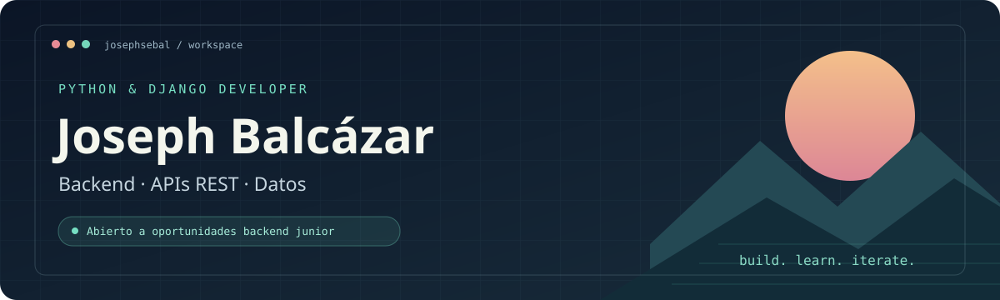

**Python · Django · Django REST Framework · PostgreSQL**

Desarrollo aplicaciones web y APIs que conectan datos con necesidades reales.

[LinkedIn](https://www.linkedin.com/in/joseph-balcazar-loaiza-33324228b) · [Proyectos](#proyectos-destacados) · [Trayectoria en GitHub](https://github.com/jcbastianl)

**Abierto a oportunidades como desarrollador backend junior y pasantías.**

---

## `$ whoami`

Soy **Joseph Balcázar**, estudiante de Ingeniería de Software en la **Universidad Nacional de Loja**, con enfoque en desarrollo backend con **Python y Django**.

En mis proyectos personales y académicos trabajo con APIs REST, modelos relacionales, autenticación, consultas con el ORM e integración con interfaces web. Me interesa convertir requisitos en funcionalidades claras y seguir creciendo junto a un equipo de desarrollo.

## `$ cat stack.yaml`

| Área | Tecnologías y práctica |
| :--- | :--- |
| **Backend principal** | Python · Django · Django REST Framework |
| **APIs y datos** | PostgreSQL · Django ORM · Serializers · filtros · paginación |
| **Integraciones** | Autenticación JWT · documentación OpenAPI / Swagger · carga de archivos |
| **Herramientas** | Git · GitHub · Linux · Render |
| **Frontend complementario** | Vue · JavaScript · React / Next.js · HTML · CSS |
| **Exploración IoT** | MicroPython · ESP32 · bots de Telegram |

## Proyectos destacados

### 01 / Visor de siniestros
**Django · Django REST Framework · PostgreSQL · pandas**

Backend para consultar siniestros de tránsito y generar información para un visor estadístico. Incluye filtros, indicadores, distribuciones temporales y datos para mapas.

- API de consulta con ViewSets, serializers y filtros con django-filter.
- Agregaciones mediante el ORM para indicadores y evolución anual.
- Caché de respuestas y documentación de endpoints con drf-spectacular.

[Explorar repositorio →](https://github.com/jcbastianl/visor_siniestros) · [Ver implementación de la API](https://github.com/jcbastianl/visor_siniestros/blob/main/siniestros/views.py)

### 02 / Recetario
**Python · Django REST Framework · JWT · Vue**

Aplicación de recetas con backend e interfaz web. El backend gestiona recetas, categorías, usuarios e imágenes.

- Endpoints para consultar y crear recetas, con validación de datos.
- Autenticación con JWT y rutas protegidas.
- Carga de imágenes y documentación de operaciones con Swagger.

[Backend →](https://github.com/jcbastianl/backendRecetario) · [Aplicación y frontend →](https://github.com/jcbastianl/Recetario)

### 03 / PetFeeder
**MicroPython · ESP32 · Telegram**

Adaptación de un alimentador automático con control desde Telegram. El repositorio parte del proyecto de hardware de [hardrive9000/PetFeeder](https://github.com/hardrive9000/PetFeeder) y documenta una implementación de firmware en MicroPython.

- Comandos para alimentar, detener y consultar el estado.
- Lista de chats permitidos y controles de tiempo entre activaciones.
- Integración de conectividad Wi-Fi, motor e indicadores LED.

[Explorar proyecto y documentación →](https://github.com/jcbastianl/PetFeeder)

Estos proyectos se publicaron en mi cuenta anterior, <a href="https://github.com/jcbastianl">@jcbastianl</a>. Ahora continúo mi trabajo en <a href="https://github.com/josephsebal">@josephsebal</a>.

## `$ connect`

Busco una oportunidad para aportar en **desarrollo backend con Python/Django**, implementar funcionalidades, trabajar con datos e integrar APIs dentro de un equipo.

**¿Conversamos?** [Conecta conmigo en LinkedIn](https://www.linkedin.com/in/joseph-balcazar-loaiza-33324228b).

---

Joseph Balcázar · Python &amp; Django 
Perfil inspirado en <a href="https://github.com/macu-dev/macu-dev">macu-dev/macu-dev</a>. Diseño y contenido adaptados a mis proyectos.

